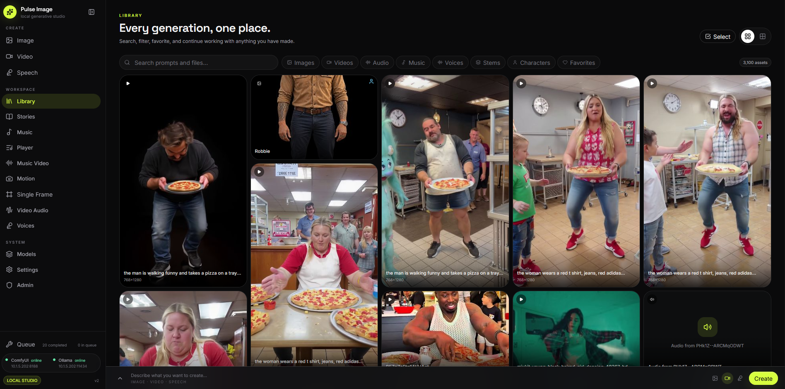
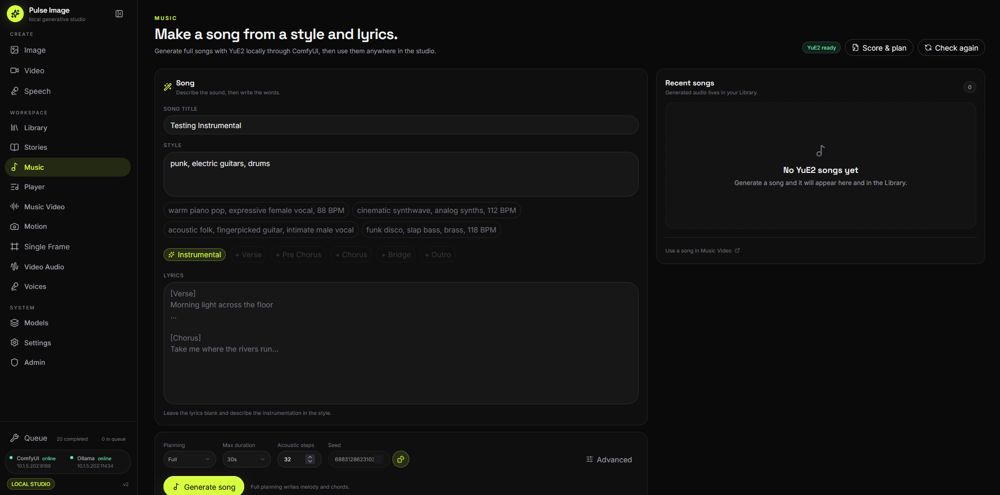
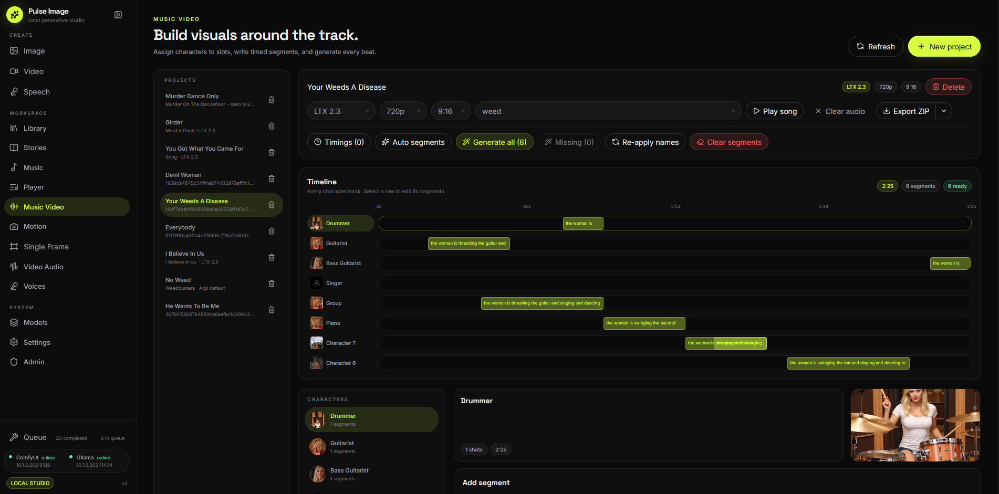
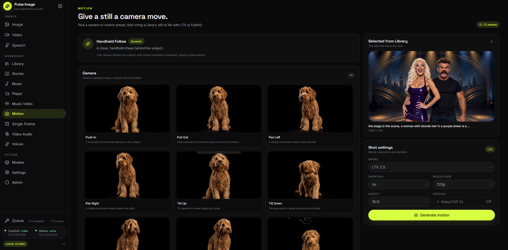
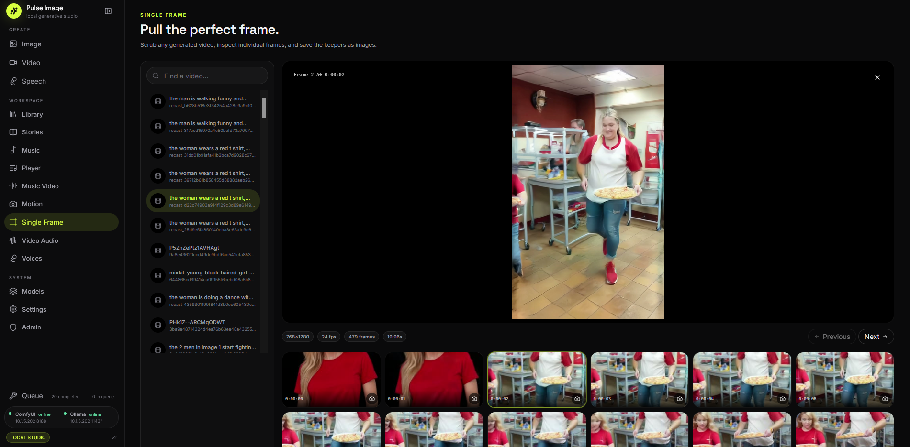
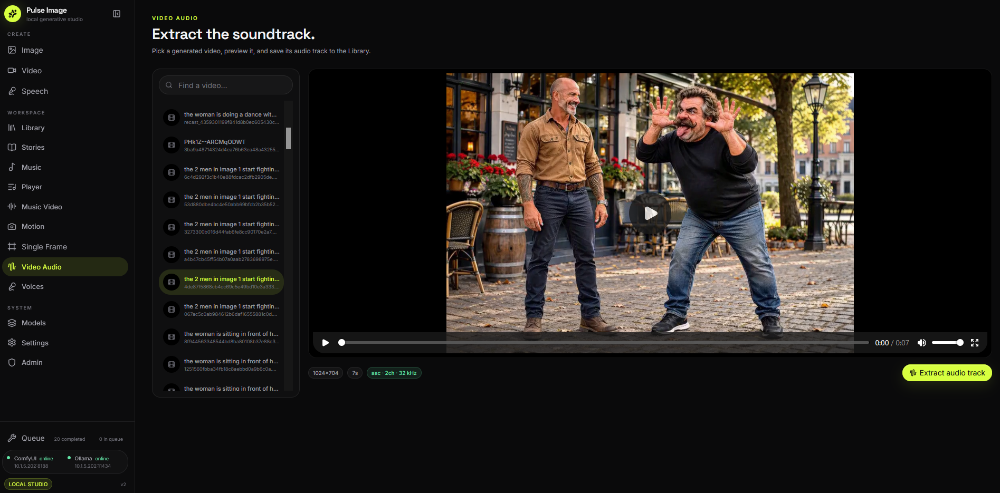
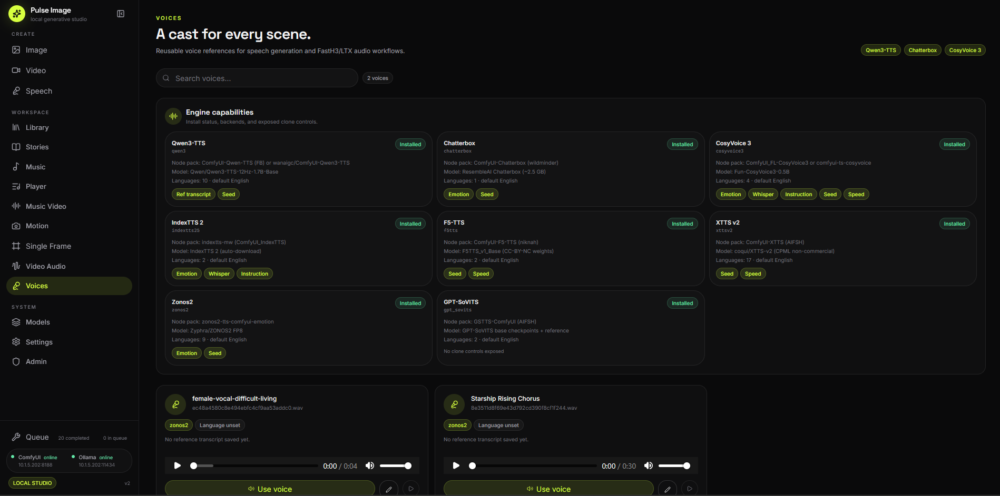
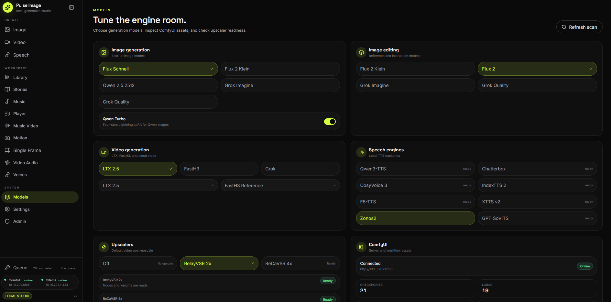
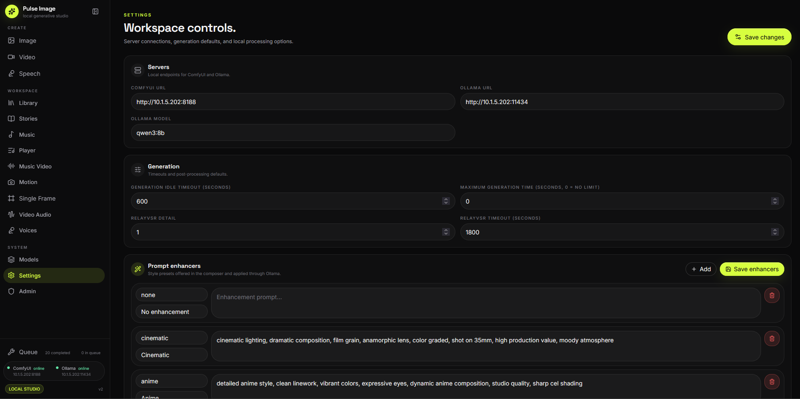
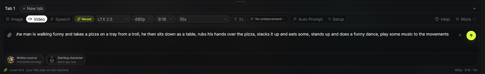

# Pulse Image

Local-first AI studio for image, video, speech, music, music-video, stories, and character-driven recast generation.

Written by Pulse Harmonix

**Early/experimental version.** The project is under active development.

<p align="center">
  
</p>

---

## DISCLAIMERS

- This software is provided "as is" for personal, educational, and experimental use only.
- It depends on third-party AI systems (ComfyUI and Ollama). You are responsible for downloading and using models in compliance with their licenses.
- Generated content may contain visual artifacts, unexpected results, or biased outputs.
- The developers accept no liability for content created with this tool or for issues arising from its use.
- Always review and respect the terms of service of ComfyUI, Ollama, and the model creators.

---

## FEATURES

- **Studio** - prompt composer for image, video, and speech with attachments, prompt tabs, model controls, a global queue, LTX/FastH3 recast, source-audio modes, and source-length recast durations.
- **Library** - searchable asset grid, filters, bulk actions, drag/drop import, fullscreen inspector, To Prompt, variations, video upscaling, image editing, music covers, character profiles, and score/plan views.
- **Stories** - premise-to-storyboard planning, cast selection, scene setup, scene reference kits, FastH3 keyframes/anchors, shot clips, and ZIP export.
- **Characters** - character profiles stored on library image assets, with appearance/wardrobe notes, aliases, tags, voice links, and additional reference images.
- **Recast** - source-video performance transfer with FastH3 or experimental LTX 2.3/2.5, starting-image identity, optional pose/Canny/depth control, audio copy/freeze/mute, optional post-upscale, and LTX durations up to 120 seconds subject to available VRAM.
- **Video Audio** - inspect a generated video, extract its audio track, and save it to the Library.
- **Music Video** - projects, character slots, timed sections, draggable segment timeline, section playback, auto-generation, ZIP export, and Lightworks 2026 FCP7 XML package export.
- **Music Generator** - YuE2 song generation and covers, unique song titles, recent songs, sheet music, vocal timing, and score/plan details.
- **Stems** - lazy six-stem extraction for any audio asset with a synchronized mixer, waveforms, and export of the current audible stem selection as a new audio asset.
- **Single Frame** - scrub generated videos and save full-resolution frames to the Library.
- **Motion** - prompt-based camera/motion presets and image-to-video with LTX/FastH3, using previews from `motion-presets/`.
- **Low-resolution modes** - image and video resolution selectors include 240p and 320p, with dimensions aligned to the active model's grid.
- **Voices** - TTS engine readiness, voice metadata, transcript/language editing, and speaker previews.
- **Models and Settings** - model selection, workflow-asset audits across checkpoints, LoRAs, VAEs, CLIPs, upscalers, audio encoders, and ReCaVSR assets; LoRA listing, ComfyUI/Ollama URLs, prompt enhancers, generation timeouts, upscaler defaults, and raw settings.
- **Admin** - raw settings editing, library flag editing/deletion, and thumbnail backfill.

---

## SCREENSHOTS

| Music Generator | Music Video |
| :---: | :---: |
|  |  |
| **Motion** | **Single Frame** |
|  |  |
| **Video Audio** | **Voices** |
|  |  |
| **Models** | **Settings** |
|  |  |

### Composer

<p align="center">
  
</p>

---

## SYSTEM REQUIREMENTS

- Python 3.12+
- Node.js 20.19+ or 22.12+ and npm
- FFmpeg and ffprobe on `PATH` for frame extraction, audio extraction/trimming, duration checks, recast source preparation, and output finalization
- A running ComfyUI instance (local or remote)
- An Ollama instance for prompt enhancement and story planning (optional for basic generation)
- A GPU with enough VRAM for the selected ComfyUI models; 22B LTX workflows are intended for high-VRAM systems
- Rust only if you want to build the optional Tauri desktop shell

---

## MODELS AND SERVICES

Exact required filenames are defined in the workflow JSON files under `workflows/` and audited on the **Models** page.

**Ollama**
- `qwen3:8b` is the recommended/default prompt-enhancement model.

**ComfyUI image models**
- Flux Schnell
- Flux 2 Klein
- Flux 2
- Qwen Image 2512
- Grok Imagine / Grok Imagine Quality (cloud xAI, optional)

**ComfyUI video models**
- LTX 2.3 and LTX 2.5
- LTX 2.3 Union Control IC-LoRA (`ltx-2.3-22b-ic-lora-union-control-ref0.5.safetensors`) for LTX recast control/identity guidance
- FastH3 (reference, first-frame, image+audio, and multi-reference flows)
- Grok Imagine video (cloud xAI, optional)
- RelayVSR X2 (optional video post-upscale)
- ReCaVSR X4 (optional experimental 4x video post-upscale; H.264 output limits apply)

**ComfyUI music models**
- YuE2 native nodes with `yue2_3b_int8_convrot.safetensors`
- SheetSage2 audio encoder (`sheetsage2_bf16.safetensors`) for audio-to-ABC cover transcription
- `ComfyUI-Demucs-AudioSeparator` with the `htdemucs_6s` model for lazy six-stem extraction

**Recast notes**
- FastH3 is the primary recast engine; LTX 2.3/2.5 are experimental.
- LTX recast uses the installed Union Control IC-LoRA, source guide control, and starting-image identity guides.
- Recast sources without an audio track automatically fall back to mute instead of failing.
- Optional ReCaVSR X4 output is limited to 4096 px per side / 4K total pixels for browser-compatible H.264.

**Speech**
- Qwen3-TTS
- Chatterbox
- CosyVoice 3
- IndexTTS 2
- F5-TTS
- XTTS v2
- Zonos2
- GPT-SoVITS

Engine install status and supported controls are shown on the **Models** and **Voices** pages.

---

## INSTALLATION

1. Install Python 3.12+ and Node.js.
2. Create and activate a virtual environment:

   ```powershell
   python -m venv venv
   venv\Scripts\Activate.ps1
   ```

3. Install the backend dependencies:

   ```powershell
   pip install -r requirements.txt
   ```

4. Install and build the React frontend:

   ```powershell
   cd frontend
   npm install
   npm run build
   cd ..
   ```

5. Ensure FFmpeg/ffprobe are available on `PATH`.

6. Start ComfyUI and, optionally, Ollama.

7. Start Pulse Image:

   ```powershell
   python main.py
   ```

8. Open `http://127.0.0.1:8000/`.

If the frontend has not been built, the server returns a friendly 503 page with the build command.

---

## FIRST-TIME SETUP

1. Open **Settings**.
2. Set the ComfyUI URL (usually `http://127.0.0.1:8188`) and Ollama URL (usually `http://127.0.0.1:11434`).
3. Save settings and open **Models** to check required model/workflow readiness.
4. Add or select a voice in **Voices** before using Speech generation.
5. For YuE2 music and covers, verify the YuE2/SheetSage2 nodes and checkpoint are installed.
6. For LTX recast, verify the LTX 2.3/2.5 models and Union Control IC-LoRA are installed; check **Models** for missing workflow assets.
7. For video-to-audio extraction or recast trimming, confirm FFmpeg and ffprobe are available.

### Grok Imagine (optional cloud service)

1. Create an xAI API key at https://console.x.ai.
2. Open **Admin -> Settings Editor**.
3. Set `xai_api_key` and save.
4. Choose a Grok image/video model on **Models** or in the composer.

Grok still requires network access and a valid API key. ComfyUI generation paths remain local.

---

## DEVELOPMENT

Start the backend:

```powershell
python main.py
```

Start the Vite dev server in a second terminal:

```powershell
cd frontend
npm run dev
```

Open `http://127.0.0.1:5173/`. The dev frontend calls the FastAPI server at `http://127.0.0.1:8000`.

Frontend checks:

```powershell
cd frontend
npm run build
npm run lint
```

Backend syntax check:

```powershell
python -m compileall -q main.py config.py routers services utils
```

---

## ROUTING AND STORAGE

- The React app is served at `/`.
- Client-side routes include `/library`, `/stories`, `/songs`, `/music`, `/motion`, `/player`, `/frames`, `/video-audio`, `/voices`, `/models`, `/settings`, and `/admin`.
- Deep links fall back to the React index.
- Legacy `/app` URLs redirect to their root equivalents.
- SQLite is the primary data store in `pulseimage.db`.
- Generated media is stored in `images/`, `videos/`, `audio/`, and `thumbnails/`.
- `/motion-presets` serves drop-in preset preview videos and is not part of the Library.

---

## PROJECT STRUCTURE

```text
PulseImage/
|-- main.py                  # FastAPI entry point and SPA serving
|-- config.py                # Settings defaults and DB loading
|-- requirements.txt         # Python dependencies
|-- LICENSE                  # PolyForm Noncommercial 1.0.0
|-- docs/images/             # README screenshots
|-- frontend/                # React studio (Vite + TypeScript)
|   |-- src/                 # Pages, components, API client, stores
|   `-- dist/                # Production build served by FastAPI
|-- routers/                 # FastAPI API routes
|   |-- admin.py
|   |-- characters.py
|   |-- comfy.py
|   |-- frames.py
|   |-- generations.py
|   |-- music.py
|   |-- ollama.py
|   |-- settings.py
|   |-- songs.py
|   |-- stems.py
|   |-- story.py
|   |-- tts.py
|   |-- uploads.py
|   |-- video_audio.py
|   `-- ...
|-- services/                # ComfyUI, recast, story, media, database, TTS, music services
|-- utils/                   # Workflow modification helpers
|-- workflows/               # ComfyUI workflow JSON templates
|-- images/                  # Generated images
|-- videos/                  # Generated videos
|-- audio/                   # Generated audio
|-- thumbnails/              # Generated thumbnails and frame cache
`-- src-tauri/               # Optional Tauri desktop shell
```

---

## TROUBLESHOOTING

- **"Pulse Image UI is not built"** - run `npm run build` inside `frontend/`.
- **ComfyUI offline** - check the URL in Settings and confirm ComfyUI is running.
- **Ollama offline** - prompt enhancement is optional; check the URL and installed models.
- **Missing models** - open Models to compare installed files with the workflow requirements.
- **No frame/audio durations** - install FFmpeg and ffprobe and restart the backend.
- **Music covers unavailable** - install the SheetSage2 nodes and confirm the YuE2 checkpoint is present.
- **Stems unavailable** - install `ComfyUI-Demucs-AudioSeparator` in ComfyUI and restart it. The `htdemucs_6s` model downloads on the first separation.
- **Recast source has no audio** - recast automatically falls back to mute; choose FastH3 audio-reference mode only when the source has an audio track.
- **LTX recast missing models** - open **Models** and check the LTX 2.3/2.5 checkpoints, text encoders, VAEs, upscalers, and Union Control IC-LoRA.
- **LTX recast conditioning-frame error** - source duration is aligned to the LTX latent window; keep FFmpeg available for preparation and final trimming.

---

## LICENSE

Pulse Image is **source-available** under the [PolyForm Noncommercial License 1.0.0](LICENSE).

You may use, modify, fork, and share the software for noncommercial purposes. Commercial use, selling, paid products or services, and sublicensing or transferring the license are not permitted. Forks and modified versions distributed to others remain subject to the same noncommercial terms.

Third-party software, model weights, ComfyUI, Ollama, and other dependencies are covered by their own licenses and are not relicensed by this project.

Copyright © 2026 Pulse Harmonix.
